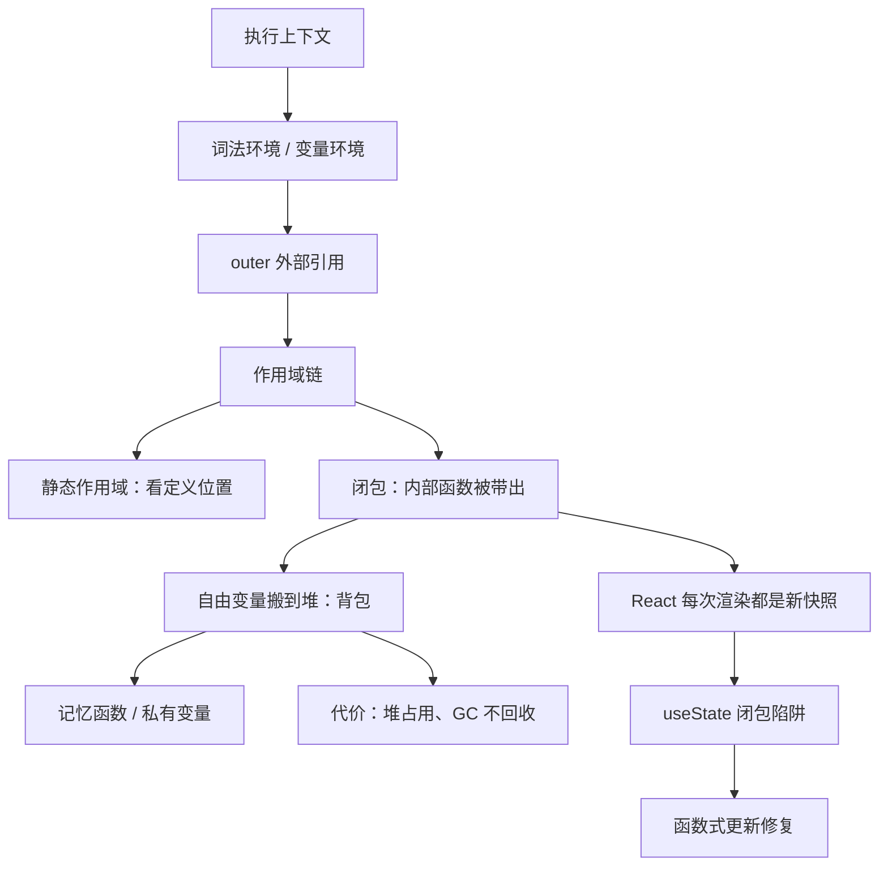

# 小米前端面试复习：闭包与 useState 的知识闭环

> 目录导航：[[#一页速览]] · [[#学习范围]] · [[#知识地图]] · [[#核心知识]] · [[#重点语法与 API]] · [[#注释重点解读]] · [[#面试高频知识]] · [[#复习卡片]] · [[#实践与复习计划]]

## 一页速览

> [!summary] 五条核心结论
> 1. 这个目录不是题库，而是一份**自测提纲**：它把「作用域链 → 闭包 → 内存 → React 状态快照」串成了一条线。
> 2. 闭包之所以能工作，是因为 JS 采用**静态（词法）作用域**：变量在哪查找，由函数**写在哪**决定，与调用位置无关。
> 3. 闭包能让函数返回后变量还活着，靠的不是栈没弹出，而是被引用的变量被**搬到了堆**（V8 的 Context 对象）。
> 4. `useState` 有三条必记规则：惰性初始化只跑首次渲染、更新是批量的、新值依赖旧值时用函数式更新。
> 5. React 的「闭包陷阱」不是新知识，就是第 2 条在组件里的自然结果：`useEffect` 空依赖把首次渲染的 `count` 锁死。

**最小心智模型**：作用域链负责「找得到」，堆负责「活得久」，React 的每次渲染负责「拍一张新快照」。三者合起来，就是这份笔记的全部。

## 学习范围

| 层级 | 文件 | 读取原因 | 覆盖 |
|---|---|---|---|
| 深读 | [readme.md](file:///c:/Users/38335/Desktop/workspace/jzh_ai/Iinterview/xiaomi/readme.md) | 唯一总纲：面试模块清单 + useState/闭包笔记 | 全量 |
| 深读 | [closure/1.js](file:///c:/Users/38335/Desktop/workspace/jzh_ai/Iinterview/xiaomi/closure/1.js) | 作用域链最小可运行示例 | 全量 |
| 深读 | [closure/2.js](file:///c:/Users/38335/Desktop/workspace/jzh_ai/Iinterview/xiaomi/closure/2.js) | 闭包保存状态（计数器） | 全量 |
| 深读 | [closure/3.js](file:///c:/Users/38335/Desktop/workspace/jzh_ai/Iinterview/xiaomi/closure/3.js) | 静态作用域反例，最有价值的一题 | 全量 |
| 深读 | [closure/4.js](file:///c:/Users/38335/Desktop/workspace/jzh_ai/Iinterview/xiaomi/closure/4.js) | 闭包封装私有变量 | 全量 |
| 深读 | [closure/1.html](file:///c:/Users/38335/Desktop/workspace/jzh_ai/Iinterview/xiaomi/closure/1.html) | 与 4.js 逻辑等价的浏览器版 | 全量 |
| 深读 | [App.jsx](file:///c:/Users/38335/Desktop/workspace/jzh_ai/Iinterview/xiaomi/usestate-closure/src/App.jsx) | useState 闭包陷阱的修复版 | 全量 |
| 深读 | [README.md](file:///c:/Users/38335/Desktop/workspace/jzh_ai/Iinterview/xiaomi/usestate-closure/README.md) | 确认是 Vite + React 模板 | 全量 |
| 浅读 | [package.json](file:///c:/Users/38335/Desktop/workspace/jzh_ai/Iinterview/xiaomi/usestate-closure/package.json) | 只取 scripts 与 React 版本（19.3.1） | 必要字段 |
| 浅读 | [package.json](file:///c:/Users/38335/Desktop/workspace/jzh_ai/Iinterview/xiaomi/package.json) | 确认根目录为 CommonJS、无实际脚本 | 必要字段 |
| 跳过 | 2 张 `屏幕截图*.png` | 二进制资产，未读取 | 未知 |
| 跳过 | `package-lock.json`、CSS、SVG、PNG、eslint/gitignore/vite 配置 | 与知识主线无关 | — |

> [!warning] 未验证项
> 全部 demo 的输出均为**按语言规则推导**，本次没有执行任何代码，也没有打开截图，因此所有「输出是 X」都属于**合理推断**，不是运行结果。

## 知识地图



依赖顺序很关键：**没有静态作用域，就没有闭包；没有闭包，就解释不了 React 的过期快照**。所以 3.js 那道「猜输出」的题，其实是整条链的地基。

## 核心知识

### 1. 执行上下文与作用域链 `[材料中出现]`

`readme.md:91-101` 把这条链写得很清楚：代码执行前要先准备执行上下文（含变量环境、词法环境），每个上下文里都有一个 `outer` 指向外层上下文，变量查找就沿 `outer` 一路走到全局。

`closure/1.js` 是最小验证：

```js
function foo() {
  function bar() {
    var a = 1
    console.log(b)   // b 不是自己的变量
  }
  var b = 2
  return bar
}
const baz = foo()
baz()                // 推断输出：2
```

`bar` 里没有 `b`，于是沿 `outer` 找到 `foo` 的 `b = 2`。**注意 `foo` 的第一次调用（第 15 行）返回值被丢弃，不会产生任何输出。**

### 2. 词法环境与变量环境 `[材料中出现]` + `[外部补充]`

笔记只提到名字（`readme.md:92`、`readme.md:97`），没有展开。补上最小区分：

| 概念 | 管什么 | 作用域单位 |
|---|---|---|
| 变量环境 | `var`、函数声明 | 函数级 |
| 词法环境 | `let`、`const`、`class` | 块级 `{}` |

两者都挂在执行上下文上，都带 `outer`。ES6 之前没有块级作用域，所以只需要一个「变量环境」；有了 `let/const` 之后，才拆成两个角色。`let` 的暂时性死区就是「绑定已创建但未初始化」的表现。

### 3. 闭包的定义与内存机制 `[材料中出现]`

`readme.md:112` 的定义可以直接背：

> 内部函数引用外部函数的变量，即使外部函数执行结束，这些变量依然保存在堆内存中，这些变量的集合称为闭包。

`readme.md:114` 又给了一个更短的说法：**闭包 = 自由变量的集合**。

`closure/1.js:18` 用了一个很好用的比喻——**背包**：函数出栈时，把自己需要的外部变量装进背包，背包放在堆里，所以人走了包还在。

> [!note] 表述精度
> 严格来说，闭包是「函数 + 它捕获的词法环境」这个整体，而不只是变量集合。`readme.md:114` 是面试导向的简化说法，答题时先给标准定义，再用「背包」解释，会更稳。

### 4. 静态作用域：整份材料最值得做的一道题 `[材料中出现]`

```js
function bar(){ console.log(myName) }   // 定义在全局
function foo(){
  var myName = 'jikeban'
  bar()                                // 在 foo 里调用
}
var myName = 'xiaomi'
foo()                                  // 推断输出：xiaomi
```

很多人会答 `jikeban`，理由是「在 foo 里调用的」。实际输出是 `xiaomi`：`bar` **定义**在全局，它的 `outer` 指向全局，与谁调用无关。

这正是 `readme.md:105-108` 反复强调的：**词法作用域在代码编译阶段就决定了，和函数怎么调用没有关系。**

### 5. 闭包的两种典型用途 `[材料中出现]`

**记忆函数**（`closure/2.js`）：`num` 被内部函数引用，外部每次 `res()` 都能读到并累加。

```js
function Add() {
  let num = 0
  return function foo() { console.log(++num) }
}
const res = Add()
res()   // 推断输出：1
res()   // 推断输出：2
```

**封装私有变量**（`closure/4.js` / `1.html`）：`myName`、`test1` 都在 `foo` 里，外部只能通过 `getName` / `setmyName` 操作。

```js
var bar = foo()
bar.setmyName('极客邦')
console.log(bar.getName())
// 推断输出：先 1（getName 内部打印 test1），再 极客邦（console.log 打印返回值）
```

这道题常被忽略的点：**`getName()` 自己 `console.log(test1)`，返回值又被外层 `console.log` 打印**，所以是两行输出，不是一行。

### 6. 闭包的代价与回收 `[材料中出现]`

`readme.md:118-125` 给出两条判断：

- 引用闭包的是**全局变量** → 闭包活到页面关闭；不再使用就是泄漏。
- 引用闭包的是**局部变量** → 函数销毁后，GC 判断并回收。

代价不只有内存：每次创建闭包都有额外的上下文开销，高频创建时会有性能成本（`readme.md:88`）。

### 7. useState 的三条要点 `[材料中出现]`

| 要点 | 材料位置 | 结论 |
|---|---|---|
| 惰性初始化 | `readme.md:59-63` | 传函数 `useState(() => heavy())`，昂贵计算只在首次渲染执行 |
| 批量更新 | `readme.md:64-74` | 多次 `setState` 合并，避免频繁重渲染 |
| 函数式更新 | `readme.md:69-73` | `setCount(prev => prev + 1)` 保证拿到更新队列里的最新值 |

> [!warning] 一处需要修正的说法
> `readme.md:64` 写「状态更新时**异步**批量更新」。更准确的说法是：`setState` **同步登记**更新，React 在事件结束后**批量调度**一次重渲染。它不是 `setTimeout` 那种异步，也不是「值慢慢变」，而是当前闭包里的变量永远是本次渲染的快照。

### 8. React 的闭包陷阱 `[材料中出现]`

`App.jsx` 里被注释掉的第 8 行就是错误写法，第 9 行是修复：

```jsx
useEffect(() => {
  const timer = setInterval(() => {
    // setCount(count + 1);            // 错误：count 永远是首次渲染的 0
    setCount((prevCount) => prevCount + 1);  // 正确
  }, 1000);
  return () => clearInterval(timer);
}, []);
```

因为依赖数组是 `[]`，effect 只跑一次，回调闭包捕获的是 `count = 0`。错误写法每秒都算 `0 + 1`，React 发现值没变就不重渲染，页面停在 `Count: 1`。函数式更新把「取最新值」交给 React，绕开了快照。

## 重点语法与 API

| 项目 | 最小写法 | 作用 | 常见坑 | 来源 |
|---|---|---|---|---|
| `outer` | 引擎内部属性，不可手写 | 指向外层词法环境，构成作用域链 | 误以为指向「调用者」 | `[材料中出现]` readme:98-101 |
| 闭包 | 内部函数被返回或传出 | 保存外部变量 | 误以为「函数套函数」就是闭包 | `[材料中出现]` 1.js:1-18 |
| 函数式更新 | `setCount(c => c + 1)` | 基于最新值更新 | 连续多次 `setCount(count + 1)` 只生效一次 | `[材料中出现]` readme:69-73 |
| 惰性初始化 | `useState(() => heavy())` | 昂贵计算只跑首次渲染 | 写成 `useState(heavy())` 每次渲染都算 | `[材料中出现]` readme:62 |
| 清理函数 | `return () => clearInterval(timer)` | 卸载时清定时器 | 漏写导致泄漏 | `[材料中出现]` App.jsx:12 |
| 块级作用域 | `let` / `const` | 限定在 `{}` 内 | 与 `var` 混淆 | `[外部补充]` |
| TDZ | 声明前访问 `let` 报错 | 避免未初始化读取 | 误以为和 `var` 一样是 `undefined` | `[外部补充]` |

## 注释重点解读

**① `closure/1.js:2`**

> 内部函数可以再外部访问……不会随着外部函数的出栈而销毁

- 核对实现：`bar` 被 `return` 出去，确实在外部调用；`b` 也确实没被销毁。
- 冲突：错别字「**再**外部访问」应为「**在**外部访问」，否则语义不通。
- 为什么：出栈销毁的是**执行上下文（栈帧）**，但被引用的变量被搬进了**堆**，两者不是一回事。

**② `closure/1.js:16-18`**

> this 指向动态 能销毁吗？……但它会将 bar 需要的 `{ b: 2 }` 保存起来

- 核对实现：成立。`baz()` 拿到 `2` 就是证据。
- 值得表扬的点：作者主动把「静态的作用域链」和「动态的 this」放在一起对比。`this` 看调用方式（`baz()` 独立调用，非严格模式是 `window`，严格模式是 `undefined`），作用域链看书写位置。
- 边界：`{ b: 2 }` 只是示意，V8 实际放进 Context 对象的是**被引用的变量绑定**，不是整个作用域对象的拷贝。

**③ `readme.md:87`**

> 可能导致再调用栈中的占用增加

- 与 `readme.md:84`「持久化的放到堆内存里」**直接矛盾**。
- 结论：应改为「导致**堆内存**持续占用」。栈帧在函数返回时已弹出，闭包不会让栈增长；栈增长只会来自过深的递归（`Maximum call stack size exceeded`）。
- 定性：`[材料推导]`，依据是同一份笔记第 84 行与 1.js:17 的自述。

**④ `readme.md:119`**

> 内存占用又比较答

- 明显笔误，应为「比较**大**」。

**⑤ `App.jsx:4-15`**

> ①~⑥ 六个编号注释

- 注释与实现一致：第 8 行被注释，说明作者已经知道错误写法；第 9 行是修复。这是**注释即证据**的典型，可以直接当面试讲稿。

## 面试高频知识

**Q1：什么是闭包？** `[材料中出现]`
函数 + 它捕获的词法环境。内部函数被带到外部后，仍能访问定义时作用域里的变量，即使外层函数已经执行完毕。（`readme.md:112`）

**Q2：闭包为什么不会被销毁？** `[材料中出现]`
因为被引用的变量被保存在堆上，只要闭包还被引用，GC 就不会回收。（`readme.md:84`、`1.js:17`）

**Q3：闭包会造成内存泄漏吗？** `[材料中出现]`
会，但要看引用关系。全局变量持有闭包 → 活到页面关闭；局部变量持有 → 函数销毁后可回收。（`readme.md:118-125`）

**Q4：`var` 和 `let` 在闭包里有什么区别？** `[外部补充]`
`for (var i...)` 的循环变量是函数级共享的，回调里拿到的是同一个 `i`；`let` 每轮迭代创建新的绑定，所以能正确捕获每一轮的值。这是闭包最经典的考点。

**Q5：静态作用域怎么证明？** `[材料中出现]`
看 `closure/3.js`：`bar` 定义在全局、在 `foo` 里调用，输出仍是全局的 `xiaomi` 而不是 `foo` 局部的 `jikeban`。说明查找依据是定义位置。

**Q6：`useState` 的初始值只在什么时候用？** `[材料中出现]`
首次渲染。之后 props 或外部值变化都不会重置它；需要重置时用 `key` 强制重建组件。

**Q7：为什么 `setState` 之后立刻 `console.log` 拿不到新值？** `[材料中出现]` + `[材料推导]`
当前渲染的 `count` 是一个常量快照，`setState` 只是登记更新、预约下一次渲染，不会修改本次闭包里的变量。

**Q8：为什么不能在条件或循环里调用 Hook？** `[外部补充]`
React 依赖 Hook 的**调用顺序**在 Fiber 上匹配状态。顺序一变，状态就串位。这和闭包无关，但常被一起问。

**Q9：React 18 的自动批处理变了什么？** `[外部补充]`
从只在 React 事件中批处理，扩展到 `setTimeout`、Promise 回调和原生事件，都会合并成一次重渲染。

**Q10：闭包的性能成本有哪些？** `[材料中出现]`
额外的上下文创建开销（高频创建时明显）+ 堆内存长期占用（`readme.md:88`、`readme.md:86`）。

## 复习卡片

> [!tip] 三句话回忆法
> 找得到 → 作用域链；活得久 → 变量上堆；拍快照 → React 每次渲染都是新闭包。

> [!warning] 三个高频错答
> 1. `closure/3.js` 答 `jikeban` → 忘了作用域看定义位置。
> 2. 说闭包「变量留在栈里」 → 错，栈帧已弹出，变量在堆。
> 3. `setCount(count + 1)` 连写三次期望 +3 → 实际只 +1。

> [!question] 自测
> - `closure/1.js` 输出几行？为什么第 15 行没有输出？
> - `closure/4.js` 输出几行？第一行是谁打印的？
> - `App.jsx` 去掉 `return () => clearInterval(timer)` 会发生什么？
> - 惰性初始化的函数会被调用几次？受 StrictMode 影响吗？

**填空提示**：

```js
// 让下面的写法在空依赖 effect 里也能正确累加
setInterval(() => {
  setCount(______);   // 提示：参数是一个函数
}, 1000);
```

## 实践与复习计划

- [ ] 当天：手写 `closure/1.js` 与 `3.js`，先猜输出再对照，重点说明「为什么不是 jikeban」
- [ ] 当天：把 `App.jsx` 的错误行取消注释跑一次，亲眼确认停在 1，再改回函数式更新
- [ ] 1 天后：用 60 秒口述「词法环境 / 变量环境 / 栈 / 堆」四个词的关系
- [ ] 3 天后：默写三种闭包写法（计数器、私有变量、循环里用 `let`），并各说一个泄漏场景
- [ ] 7 天后：不看笔记讲完「闭包 → React 快照 → 函数式更新」这条链，录音回听

> [!question] 未解决问题
> - `readme.md:53` 提到「面试的流程（时长）」，材料里没有展开，属于未知。
> - 两张截图未读取，可能包含补充结论，需要本人确认是否合并进笔记。
> - `readme.md` 的分类维度（基础/高级）只列了 `useState`，其余 Hook 未整理，可作为下一步补全项。
