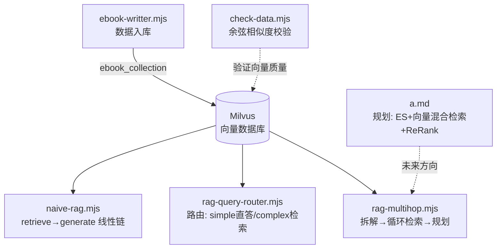

---
type: learning-summary
title: "Advanced RAG 实战：从朴素 RAG 到多跳检索"
aliases: ["Advanced RAG·学习总结", "天龙八部 RAG 实战总结"]
tags: [learning, RAG, LangGraph, Milvus, LangChain]
source_scope: "jzh_ai/ai/agent/agentic_rag/advanced-rag"
coverage:
  deep_read: ["readme.md", "a.md", "src/naive-rag.mjs", "src/rag-query-router.mjs", "src/rag-multihop.mjs", "src/ebook-writter.mjs", "check-data.mjs"]
  shallow_read: ["package.json（scripts 与依赖字段）"]
  supplement: []
  skipped: [".env（含密钥，不读取）", "pnpm-lock.yaml（锁文件）", "pnpm-workspace.yaml", "天龙八部.epub（二进制数据源）"]
review_status: learning
next_review: null
--- 

# Advanced RAG 实战：从朴素 RAG 到多跳检索

## 一页速览

[!summary] 核心结论
1. 本项目用《天龙八部》EPUB 小说做语料，走完一条 RAG 进化路线：**数据入库 → 朴素 RAG → 查询路由 → 多跳检索**，技术栈为 LangChain + LangGraph + Milvus（`.env` 中配置 OpenAI 兼容网关的 embedding 与对话模型）。
2. **朴素 RAG 是一条线性链**：`retrieve → generate`，能跑通但只会"一问一检索"，遇到需要链式推理的问题召回不准。
3. **查询路由**用 zod 结构化输出让大模型当"路由器"：简单问题直答（省一次检索成本），复杂问题才走 RAG 链路。
4. **多跳 RAG** 把复杂问题拆成有序子问题，循环"检索 → 规划器决策"，用 Map 按 id 去重、按分数排序，并用 `maxRetrievals=8` 兜底防止死循环。
5. `a.md` 笔记给出下一步方向：**混合检索（Milvus 向量 + ES 关键词）+ ReRank 重排**，解决"召回率"和"召回质量"两个独立问题。

**最小心智模型**：RAG 系统 = 数据管道（切分→向量化→入库）+ 检索管道（查询→召回→（去重/重排）→增强 Prompt→生成）。Advanced RAG 的所有改动都发生在"检索管道"中间：加路由、加拆解、加循环、加重排。

## 学习范围

| 层级 | 文件 | 说明 |
| --- | --- | --- |
| 深读 | [readme.md](../readme.md) | 仅含查询路由图的 mermaid 图，佐证图结构 |
| 深读 | [a.md](../a.md) | 学习笔记：混合检索 + ReRank 规划（未实现，属路线图） |
| 深读 | [src/ebook-writter.mjs](../src/ebook-writter.mjs) | 数据入库管道（235 行） |
| 深读 | [src/naive-rag.mjs](../src/naive-rag.mjs) | 朴素 RAG，两节点线性图（177 行） |
| 深读 | [src/rag-query-router.mjs](../src/rag-query-router.mjs) | 查询路由，条件分支图（227 行） |
| 深读 | [src/rag-multihop.mjs](../src/rag-multihop.mjs) | 多跳 RAG，循环检索图（410 行） |
| 深读 | [check-data.mjs](../check-data.mjs) | 向量质量校验脚本（36 行） |
| 浅读 | package.json | 提取依赖：`@langchain/langgraph`、`@zilliz/milvus2-sdk-node`、`zod`、`epub2`、`html-to-text` 等；`type: commonjs`，源码用 `.mjs` 走 ESM |
| 跳过 | `.env`、`pnpm-lock.yaml`、`pnpm-workspace.yaml`、`天龙八部.epub` | 密钥/锁文件/二进制语料 |

**覆盖程度**：核心源码全部完整读取；`.epub` 语料内容未读取（只关注加载方式）。**未知项**：`.env` 中的实际模型名与网关地址；所有程序**运行结果未验证**（本次为静态阅读，未执行代码）。

## 知识地图

- **数据流**：`天龙八部.epub` → EPubLoader 按章节加载 → RecursiveCharacterTextSplitter 切 500 字符 → OpenAIEmbeddings 生成 1024 维向量 → 写入 Milvus 集合 `ebook_collection`。
- **查询流（多跳版）**：`route_question` 判断 simple/complex → complex 则 `decompose_question` 拆 1~8 条子问题 → `retrieve` 逐条向量检索 → `plan_next_step` 决定继续检索还是生成 → `generate` 汇总回答。
- **入口**：各 `.mjs` 文件独立运行（顶层 `main()` 调用），无统一 CLI。

## 核心知识

### 1. 数据入库管道（ebook-writter.mjs）

**是什么**：把整本 EPUB 小说变成 Milvus 里可检索的向量集合。

**怎么工作**（关键步骤与原因）：
1. **按章节加载**：`new EPubLoader(EPUB_FILE, { splitChapters: true })`，小说天然按章节成篇，先按章切能保留章节元信息。
2. **二次切分**：`RecursiveCharacterTextSplitter({ chunkSize: 500, chunkOverlap: 50 })`。500 字符是"单块信息量"与"embedding 效果"的折中；重叠 50 字符防止句子被拦腰切断后语义丢失。未指定 separators 时默认按 `["\n\n", "\n", " ", ""]` 递归切分 [材料事实，src/ebook-writter.mjs:159-163]。
3. **Schema 设计**：集合字段含 `id`（主键，格式 `bookId_chapterNum_chunkIndex`，如 `1_111_23`）、`book_id`、`book_name`、`chapter_num`、`index`、`content`、`vector`（1024 维 FloatVector）[材料事实，src/ebook-writter.mjs:58-69]。手工生成可读主键是后续多跳去重能按 `id` 合并的前提。
4. **索引**：`IVF_FLAT` + `COSINE` + `nlist: 1024`。注释解释："IVF_FLAT：把向量聚类分成很多小桶，检索时只扫最相关的几个桶，速度快；先分桶，只在目标桶里暴力比对" [材料事实+注释解读，src/ebook-writter.mjs:77-81]。
5. **流式插入**：按章节循环，每章切完立即向量化并插入，边处理边写库，避免整本书一次性载入内存。

**容易错在哪里**：索引类型决定检索参数——`IVF_FLAT` 用 `nprobe`，`HNSW` 用 `ef`。本项目建库用 IVF_FLAT，但 `rag-query-router.mjs:193-198` 连接时却传了 `HNSW` + `ef: 64`，**参数与实际索引不匹配**（材料内部冲突，静态阅读发现，运行影响未验证）。

### 2. 朴素 RAG：LangGraph 最小闭环（naive-rag.mjs）

**是什么**：`START → retrieve → generate → END` 两节点线性图，是所有 Advanced RAG 的对照组。

**怎么工作**：
- 状态用 `Annotation.Root({ question, k, documents, generation })` 声明，LangGraph 节点间靠返回**状态增量**传递数据 [材料事实，src/naive-rag.mjs:18-23]。
- `retrieveNode` 调 `vectorStore.similaritySearchWithScore(question, k)`，把结果整理成 `{score, content, id, book_id, chapter_num, index}` 扁平对象；try/catch 包裹，失败返回空数组实现优雅降级 [材料事实，src/naive-rag.mjs:43-67]。
- `generateNode` 把片段拼成带 `[片段N] 章节` 标注的 context，Prompt 含 5 条回答要求，其中"如果没有相关信息请如实告知"是**防幻觉指令** [材料事实，src/naive-rag.mjs:73-87]。
- 流式输出：`model.stream(prompt)` + `for await...of` 逐 chunk 打印并拼接 [材料事实，src/naive-rag.mjs:90-96]。
- 集合加载容错：`loadCollection` 报错时若 message 含 "already loaded" 则视为正常 [材料事实，src/naive-rag.mjs:135-143]。

**为什么它是"朴素"的**：不管问题是什么都检索一次、检索一次就生成——简单问题浪费一次检索，复杂问题一次检索召回不足。

### 3. 查询路由：让大模型先"分诊"（rag-query-router.mjs）

**是什么**：在检索前加一个 `route_question` 节点，用结构化输出把问题分成 simple/complex 两类，走不同分支。

**怎么工作**：
- `RouteSchema = z.object({ strategy: z.enum(["simple", "complex"]), reason: z.string() })`，用 **zod 枚举约束**模型输出，保证代码分支可靠 [材料事实，src/rag-query-router.mjs:41-45]。
- `model.withStructuredOutput(RouteSchema)` 把 ChatOpenAI 包装成结构化输出模型，`invoke` 直接返回符合 schema 的对象 [材料事实，src/rag-query-router.mjs:117]。
- 分支用**条件边**：`addConditionalEdges("route_question", decideNext, { direct_answer: "direct_answer", retrieve: "retrieve" })`，`decideNext` 函数返回 map 的 key [材料事实，src/rag-query-router.mjs:171-174]。
- simple 走 `direct_answer`（不建 vectorStore 依赖的检索，直接流式回答），complex 走 `retrieve → rag_generate`。

**为什么值得做**：笔记 a.md 明确写"所有问题都走检索"是浪费，"区分出简单问题，省资源" [材料事实，a.md:84]。这就是 Agentic RAG 的第一层"自主决策"。

**容易错在哪里**：该文件测试问题是"js写一个add函数"（simple 类），但建库索引是 IVF_FLAT、查询却配 HNSW/ef（见第 1 节冲突点）；函数名拼成 `mian` [材料事实，src/rag-query-router.mjs:184]。

### 4. 多跳 RAG：拆解 + 循环检索（rag-multihop.mjs）

**是什么**：解决"一跳答不了"的链式推理问题。文件头注释给出动机："段遇遇到的第一个神仙姐姐画像，是谁的弟子？直接把 query 向量化匹配不够准确" [材料事实+注释解读，src/rag-multihop.mjs:1-2]。测试问题更典型：四大恶人排第二是谁（叶二娘）→ 其之子（虚竹）→ 生父在武林中的公开身份（少林方丈玄慈）——答案链条跨三跳，单次向量检索很难同时命中。

**怎么工作**（四个关键机制）：
1. **子问题拆解**：`DecomposeSchema` 约束输出 `sub_questions`（1~8 条字符串数组）。Prompt 立了硬规矩：每条必须是可独立检索的完整问句、禁止"他/她/此人"指代、顺序符合推理链（先查前置实体再查结论）[材料事实，src/rag-multihop.mjs:133-156]。禁止指代是关键——子问题要单独拿去向量化，代词会毁掉语义。
2. **循环检索 + 去重**：`retrieveNode` 每轮只取 `subQuestions[nextSubIdx]` 一条去检索，`mergeUnique` 用 `Map` 按 `id` 去重、保留分数更高的那条、按分数降序排序 [材料事实，src/rag-multihop.mjs:174-186]。注释解释为什么去重："多轮 retrieve 有可能重复，会浪费资源；重复可能让 llm……错觉"（即重复文档会强化噪声）[注释解读，src/rag-multihop.mjs:202-203]。
3. **规划器决策（Agent 核心）**：`plan_next_step` 节点把"子问题进度 + 已召回文档摘要 + 轮次"喂给模型，让它输出 `nextAction: retrieve | generate`；代码再叠加两条**硬性规则**兜底：剩余子问题为 0 或 `retrievalCount >= maxRetrievals(8)` 时强制 generate，不信任模型"想继续检索"的决定 [材料事实，src/rag-multihop.mjs:228-287]。这是"LLM 建议 + 代码硬约束"的典型安全模式。
4. **循环图结构**：`retrieve → plan_next_step` 之间用条件边回环：`addConditionalEdges("plan_next_step", afterPlan, { retrieve: "retrieve", generate: "generate" })`，LangGraph 允许边指向已走过的节点形成循环 [材料事实，src/rag-multihop.mjs:346-350]。

**容易错在哪里**（静态阅读发现的 3 个必错/逻辑问题，运行未验证）：
- [!warning] `retrieveRelevantContent(question, k = TOP_K)` 中的 `TOP_K` 在本文件**未定义**（只在 naive-rag.mjs 定义过），一旦走默认参数直接 ReferenceError [src/rag-multihop.mjs:113]。
- [!warning] `afterPlan(state)` 判断的是 `state.strategy === "retrieve"`，但 `strategy` 存的是路由结果 simple/complex，永远不等于 "retrieve"，导致规划器**永远走 generate**，循环失效；应判断 `state.plannedNext` [src/rag-multihop.mjs:233-235]。
- [!warning] 末尾 `main().then(err => console.error(err))` 应为 `.catch`——`.then` 只在成功时执行，异常不会被打印 [src/rag-multihop.mjs:409-410]。
- 次要：一处日志拼接错字"加载zhaugntai"（状态）[src/rag-multihop.mjs:394]。

### 5. 向量质量校验（check-data.mjs）

**是什么**：入库后的"质检"脚本——取一条含阿朱剧情的正文和一条无关正文，手写余弦相似度公式，验证"阿朱的结局"问题的向量确实与相关正文更接近 [材料事实，check-data.mjs:29-35]。对应实战教训：API 网关偶发故障可能把损坏向量写进库，导致检索分数异常低（如 COSINE ≈ 0.08）却毫无感知，校验脚本能提前暴露这种脏数据。

### 6. 规划中的下一步：混合检索 + ReRank（a.md，未实现）

**是什么**：a.md 是路线图笔记，核心判断：
- 向量检索胜在语义、输在关键词精确匹配；ES 关键词检索相反 → **两路召回互补** [材料事实，a.md:3]。
- ReRank 模型 = "输入用户问题 + 一段文档，输出相关度分数"的小模型，特点"体积小，推理快，成本极低"，专职给混合召回的大结果集去噪、精简，因为"大模型上下文窗口有限""噪声太多会让模型幻觉增加" [材料事实，a.md:16-27, 51-54]。
- 完整设想流程：问题改写成 3-5 个角度 → 每个问题同时查 ES + Milvus → 合并去重 → ReRank 打分取前 N → 增强 Prompt [材料事实，a.md:69-71]。

**注意**：这部分**只有笔记没有代码**，属于规划，不与已实现代码混为一谈。

## 重点语法与 API

| API / 语法 | 最小写法 | 作用与坑 | 位置 |
| --- | --- | --- | --- |
| LangGraph 状态声明 | `Annotation.Root({ question: Annotation })` | 声明共享状态 schema；节点返回对象即状态更新 | [材料中出现] naive-rag.mjs:18 |
| 建图 | `new StateGraph(GraphState).addNode().addEdge(START, "x").compile()` | 必须 compile 才能 invoke；每个节点要有从 START 可达的路径，否则编译报"unreachable node" | [材料中出现] 三份 rag 源码 |
| 条件边 | `addConditionalEdges(node, fn, { a: "nodeA", b: "nodeB" })` | fn 返回值必须是映射表的 key；是实现分支和循环的关键 | [材料中出现] router:171, multihop:347 |
| 图可视化 | `(await graph.getGraphAsync()).drawMermaid({ withStyles: true })` | 导出 mermaid 文本；readme.md 存的即此输出 | [材料中出现] 各源码尾部 |
| 结构化输出 | `model.withStructuredOutput(z.object({ strategy: z.enum([...]) }))` | zod 约束 LLM 输出；枚举让分支判断可靠 | [材料中出现] router:117, multihop:62,142,276 |
| 流式生成 | `const stream = await model.stream(prompt); for await (const chunk of stream)` | chunk.content 需判型为 string；边打印边拼接 | [材料中出现] 各 generate 节点 |
| Milvus 连已有集合 | `Milvus.fromExistingCollection(embeddings, { collectionName, textField, primaryField, vectorField })` | 三字段必须与建库 schema 一致，否则检索映射错位 | [材料中出现] naive-rag.mjs:122 |
| 索引匹配参数 | IVF_FLAT→`nprobe`；HNSW→`ef` | 检索参数必须与索引类型匹配；本项目存在 IVF_FLAT 建库/HNSW 查询的不一致 | [材料推导+外部补充] writter:79 vs router:195 |
| Map 去重 | `map.get(key)` 比较分数后 `map.set`，`Array.from(map.values()).sort()` | key 用 `String(d.id)` 统一类型；一次遍历完成"去重+保优" | [材料中出现] multihop:174-186 |
| ESM 顶层 await | `.mjs` 扩展名（package.json 为 commonjs） | 顶层 `await graph.getGraphAsync()` 依赖 ESM；commonjs 项目用 .mjs 单文件启用 | [材料推导] package.json + 源码 |

## 注释重点解读

- **IVF_FLAT 分桶注释**（ebook-writter.mjs:77-79）："把向量聚类分成很多小桶，检索时只扫最相关的几个桶，速度快；先分桶，只在目标桶里暴力比对"——解释了 IVF（倒排文件）的取舍：比全库暴力搜索快，比 HNSW 图索引简单，代价是 nprobe 小了可能漏桶。已核对与 nlist:1024 的建库参数一致。
- **多跳去重动机注释**（rag-multihop.mjs:202-203）："多轮 retrieve 有可能重复，会浪费资源 / 重复可能让 llm 我们在强调，错觉"——语句不通顺但意图明确：重复片段既浪费上下文窗口，又会被模型当作强调信号放大噪声。与 mergeUnique 实现一致。
- **多跳动机注释**（rag-multihop.mjs:1-2）："段誉遇到的第一个神仙姐姐画像，是谁的弟子？直接把 query 向量化匹配不够准确"——交代了子问题拆解的存在理由。注：正文用例换成了四大恶人问题，注释里的例子严格说是"神仙姐姐画像（王语嫣之母王夫人）的弟子是谁"这类多跳题。
- **默认分隔符注释**（ebook-writter.mjs:159）："没指定 separators 默认为 ["\n\n", "\n", " ", ""]"——说明递归切分的优先级顺序，与 LangChain 文档一致 [外部补充核对]。

## 面试高频知识

**Q1：RAG 的基本流程？为什么需要它？** [材料中出现]
检索增强生成 = 先从外部知识库检索相关片段，拼进 Prompt 再让 LLM 回答。解决模型知识过时、私有数据不知道、幻觉三大问题。本项目即小说私有语料问答。

**Q2：朴素 RAG 有哪些不足，Advanced RAG 怎么改进？** [材料推导，基于本项目演进路线]
朴素 RAG"一问一检索一生成"：简单问题浪费检索开销；复杂多跳问题一次召回不足。改进手段按本项目顺序：① 查询路由（simple 直答省资源）；② 查询拆解 + 循环检索（多跳链式推理）；③ 规划器决定检索几轮（Agent 化）；④ 规划中：混合检索 + ReRank（提升召回率与质量）。

**Q3：混合检索为什么是"向量 + 关键词"两路？** [材料中出现，a.md]
向量检索懂语义但精确词不敏感（人名、专名可能召回不准）；关键词检索（ES/BM25）精确匹配强但不懂同义改写。两路召回后合并去重，互补短板。

**Q4：为什么要 ReRank，它和 embedding 模型有何区别？** [材料中出现，a.md]
混合召回带来大量冗余，上下文窗口有限，噪声增加幻觉。ReRank 是"问题+文档→相关度分数"的交叉编码小模型，精度高于双塔 embedding，体积小、成本低，只对候选集精排（先过滤再精简）。

**Q5：LangGraph 的状态图核心概念？** [材料中出现]
`Annotation.Root` 定义共享状态；节点是"接收状态→返回状态增量"的函数；`addEdge` 固定流转、`addConditionalEdges` 按函数返回值分支；条件边可以指回已访问节点形成**循环**（多跳检索的引擎）；`compile()` 后 `invoke()` 执行。

**Q6：如何让 LLM 输出可用于代码分支？** [材料中出现]
zod schema + `withStructuredOutput`，用 `z.enum` 收紧取值域（如 simple/complex、retrieve/generate），避免解析自由文本的不稳定。

**Q7：多跳 RAG 怎么防止无限循环？** [材料推导，基于本项目实现]
三层保险：子问题列表有限（1~8 条）；`maxRetrievals=8` 轮数上限；规划器提示词写硬性规则"轮数到顶/子问题用完必须 generate"，且代码侧强制覆盖模型决定。LLM 建议永远要过代码校验。

**Q8：向量入库前后如何保证质量？** [材料中出现+材料推导]
入库时固定维度（1024）、可读主键（book_chapter_chunk）；入库后用校验脚本对比"相关/无关文本"与查询的余弦相似度，能发现 API 网关故障写坏的向量。

## 复习卡片

[!tip] 术语对比
- **IVF_FLAT vs HNSW**：分桶后桶内暴力比对 vs 图导航近邻；参数 nprobe vs ef
- **embedding vs ReRank**：双塔各自编码、快而粗、建库时全量跑 vs 交叉编码、慢而准、查询时候选集精排
- **simple vs complex 路由**：省一次检索开销 vs 换取召回完整性

[!warning] 错误→原因→排查
- `TOP_K is not defined` → 默认参数引用了别的文件的常量 → 同文件内补 `const TOP_K = 5`
- 图编译报 unreachable node → 节点没有从 START 出发的可达边 → 补边或删孤儿节点（此前调试 multihop 时真实遇到过）
- 检索分数异常低（~0.08）→ 入库时向量被写坏 → check-data.mjs 校验，必要时清库重建

[!question] 代码填空提示
1. 条件边注册：`addConditionalEdges("route_question", decideNext, { ____: "direct_answer", ____: "retrieve" })`（fn 返回值必须命中 key）
2. Map 去重保优：`if (!prev || Number(d.score) > Number(prev.score)) map.____(key, d)`
3. 流式拼接：`for await (const chunk of stream) { generation ____ text }`

**问答卡片**（5 条）
1. 多跳拆解的子问题为什么禁止"他/她"指代？→ 子问题要独立向量化，代词无语义锚点
2. 为什么要用结构化输出而不是让模型返回 JSON 字符串？→ schema 校验 + 枚举约束，解析失败/越值在源头暴露
3. mergeUnique 为什么保留分数高的那条？→ 同一片段多轮命中说明高相关，留高分版本排序更有利
4. 规划器为什么不能全信模型的 nextAction？→ 模型可能坚持继续检索，代码硬规则兜底防死循环和资源浪费
5. 朴素 RAG 的两节点是什么？→ retrieve（向量检索 top-k）→ generate（context 增强 Prompt + 流式生成）

## 实践与复习计划

**材料未含运行结果，以下实践均属"运行未验证"状态，需自行执行确认。**

- [ ] 当天：按顺序跑通 `ebook-writter.mjs`（需 Docker 里 Milvus 起在 localhost:19530）→ `naive-rag.mjs`，观察流式输出；跑 `check-data.mjs` 确认相似度符合预期
- [ ] 1 天后：修复 multihop 三个必错点（TOP_K 未定义 / afterPlan 判断 plannedNext / .then 改 .catch），跑通四大恶人多跳问题，数一数实际检索了几轮
- [ ] 3 天后：把 rag-query-router 的查询索引参数改回 IVF_FLAT + nprobe，对比检索分数；用 `drawMermaid` 输出三个图的拓扑差异并手画一遍
- [ ] 7 天后：按 a.md 路线图实现最小混合检索原型（ES + Milvus 双路召回 + 去重），评估是否需要接 ReRank 模型

[!question] 未解决问题
1. `rag-query-router.mjs` 的 HNSW/ef 查询参数与 IVF_FLAT 建库索引不匹配，运行时是报错还是静默降级？（静态阅读无法确认，需实测）
2. a.md 中"jev m模型"所指为何（疑为笔误），无上下文可考，标为未知。
3. 多跳规划器提示词中"做大检索轮数上限"当 `maxRetrievals` 未传入时依赖 `?? 8` 兜底，初始状态未显式给 `maxRetrievals`/`retrievalCount` 字段，依赖 routeQuestionNode 初始化，若路由直接命中 simple 分支则无影响——但该初始化逻辑较隐式，值得重构时显式化。
